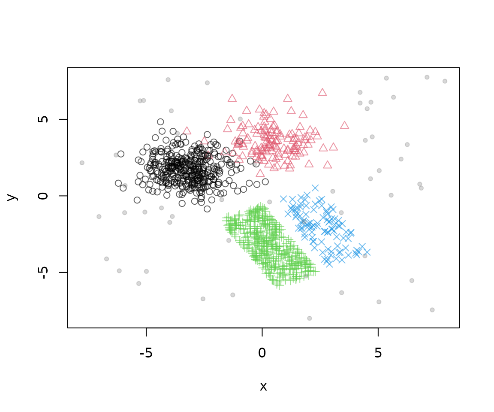
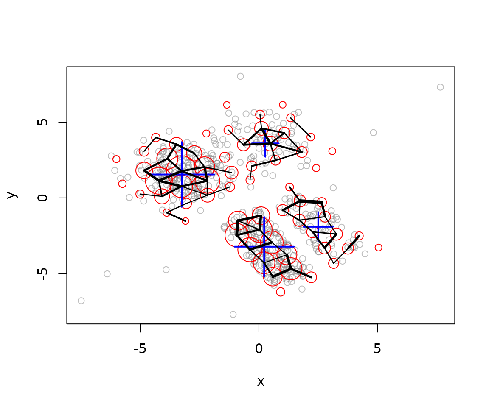
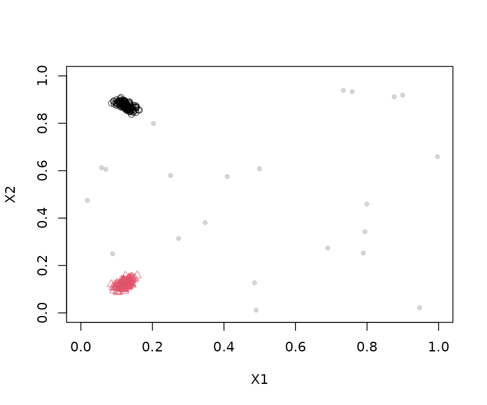
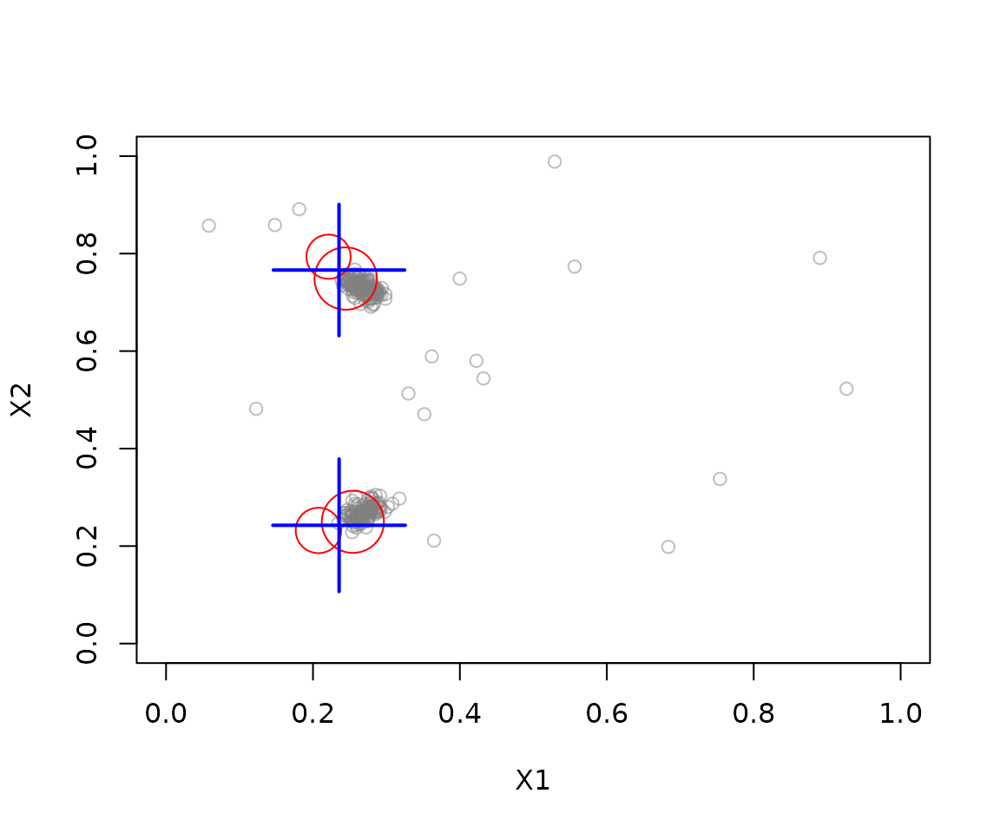

# Clustering data streams with DBSTREAM

The package `stream` provides the reference implementation of the
DBSTREAM algorithm (Hahsler and Bolaños, 2016), a density-based data
steam clustering algorithm that uses density between micro-clusters via
a shared density graph to form larger clusters.

## Advantages of DBSTREAM

- **Single pass with bounded memory.** Each point is processed once as
  it arrives and is only used to update a small set of micro-clusters,
  so the stream never needs to be stored.
- **No need to specify the number of clusters.** The number of
  macro-clusters follows from the data and the shared-density threshold
  `alpha`, rather than being fixed in advance as in k-means-style
  methods.
- **Arbitrarily shaped clusters.** Because micro-clusters are connected
  by the density of points they share, reclustering can follow
  non-spherical clusters, not just compact, round ones.
- **Robust to noise.** Weak micro-clusters and weak shared-density
  entries are removed, so sparse noise does not form or join clusters.
- **Better reclustering than centers alone.** Reclustering methods that
  only use micro-cluster centers and weights can merge clusters that are
  close but separated by a low-density gap. The shared density captures
  that gap directly (Hahsler and Bolaños, 2016).
- **Adapts to change.** Fading of old observations lets the clustering
  follow an evolving stream.

## Example 1: Clustering Static Clusters with Different Densities

### Defining the data stream

The Bars and Gaussians generator contains two Gaussian clusters and two
rectangular clusters with different densities, plus noise. Store 1500
points in memory so that plots and experiments can reuse exactly the
same data.

``` r

stream <- DSD_Memory(DSD_BarsAndGaussians(noise = 0.05), n = 10000)
plot(stream, n = 1000)
```



Plotting a stream consumes points. Resetting the memory stream puts its
cursor back at the first point. We will use the first 1000 points for
training and the remaining 500 for evaluation.

``` r

reset_stream(stream)
```

### Clustering with DBSTREAM

DBSTREAM uses the radius `r` controls the scale of the micro-clusters. A
smaller radius can preserve finer structure but usually requires more
micro-clusters. Choose it relative to the scale of the features; the
value below is specific to this data. With `shared_density = TRUE`,
DBSTREAM records points shared by overlapping micro-clusters.
Reclustering uses this evidence to decide which micro-clusters belong
together. The parameter `alpha` controls the minimum shared-density
proportion needed to connect them.

``` r

dbstream<- DSC_DBSTREAM(r = 1, shared_density = TRUE, alpha = 0.3, minweight = .1)
update(dbstream, stream, n = 5000)
dbstream
#> DBSTREAM 
#> Class: DSC_DBSTREAM, DSC_Micro, DSC_R, DSC 
#> Number of micro-clusters: 64 
#> Number of macro-clusters: 4
```

Updating the clustering with 5000 points from the stream creates
micro-clusters. We can visual the clustering. Red bubbles are the
micro-clusters where the size shows how many data points they represent.
The shared density is shown as black lines. Wider lines represent more
shared density. The macro-clusters represent micro clusters connected by
sufficient shared density and are shown by big blue crosses.

``` r

plot(dbstream, dsd = stream, type = "both", shared_density = TRUE, n = 500)
```



DBSTREAM is able to identify the four clusters.

### Evaluating the clustering

Because the generator knows the true cluster of each point, we can
measure how well the macro-clusters match the truth.
[`evaluate_static()`](https://michael.hahsler.net/stream/reference/evaluate.md)
draws new points from the stream (here the next 1000, which were not
used for training), assigns them to the closest micro-cluster, and uses
that micro-cluster’s macro-cluster as the prediction. We report two
external measures:

- **Purity** is the fraction of points that belong to the majority true
  class of the cluster they were assigned to. It ranges from 0 to 1 and
  is easy to interpret, but it rewards splitting the data into many
  small clusters.
- The **adjusted Rand index** (`crand`) measures agreement between the
  clustering and the true classes, corrected for chance. It is 1 for a
  perfect match and around 0 for a random assignment, so it also
  penalizes over-splitting.

``` r

evaluate_static(dbstream, stream, n = 1000,
  measure = c("purity", "crand"), type = "macro", assign = "micro")
#> Evaluation results for macro-clusters.
#> Points were assigned to micro-clusters.
#> 
#>    purity     cRand 
#> 0.8662129 0.9106273
```

Comparing with `type = "micro"` illustrates why both measures are
useful: the many micro-clusters have high purity, but a low adjusted
Rand index because they split the true clusters into many pieces.

``` r

evaluate_static(dbstream, stream, n = 1000,
  measure = c("purity", "crand"), type = "micro")
#> Evaluation results for micro-clusters.
#> Points were assigned to micro-clusters.
#> 
#>    purity     cRand 
#> 0.9525300 0.1234921
```

## Example2: Cluster Non-Stationary Data

To be able to addapt to nonstationary data, DBSTREAM fades older
observations using `lambda`. `gaptime` determines how often weak
micro-clusters and weak shared-density entries are removed, and `Cm`
controls the minimum micro-cluster weight. These settings interact with
the stream’s speed of change and arrival rate.

### Defining a dataset with moving clusters

`DSD_Benchmark(1)` generates two clusters that move diagonally across
the unit square and intersect in the middle, together with background
noise. Plotting a stream consumes points, so we plot a short section of
a separate generator.

``` r

plot(DSD_Benchmark(1), n = 250, xlim = c(0, 1), ylim = c(0, 1))
```



### Perform dynamic stream clustering

Here we use a radius `r` of 0.05, which suits the unit square, and a
`lambda` of 0.01 so that older points are forgotten quickly enough to
follow the movement.

``` r

set.seed(1000)
moving_stream <- DSD_Benchmark(1)
moving_dbstream <- DSC_DBSTREAM(r = 0.05, lambda = 0.01)
update(moving_dbstream, moving_stream, n = 1000)
plot(moving_dbstream, dsd = moving_stream, type = "both",
  xlim = c(0, 1), ylim = c(0, 1), n = 250)
```



The following animation processes 5000 points in batches of 100 and
shows DBSTREAM’s micro- and macro-clusters after each batch.

``` r

set.seed(1000)
animation_stream <- DSD_Benchmark(1)
animation_model <- DSC_DBSTREAM(r = 0.05, lambda = 0.01)

res <- animate_cluster(animation_model, 
                       animation_stream, 
                       horizon = 100, 
                       n = 5000, 
                       wait = 0,  # for use in a notebook
                       plot.args = list(xlim = c(0, 1), ylim = c(0, 1), 
                                        type = "both"))
```


Near the crossing, the two generating clusters overlap and are hard to
separate using only the observed features. See the “Clustering moving
data” vignette for a comparison with other stream clustering algorithms
on the same data.

## References

Hahsler, M., and Bolaños, M. (2016). Clustering data streams based on
shared density between micro-clusters. *IEEE Transactions on Knowledge
and Data Engineering*, 28(6), 1449–1461.

Hahsler, M., Bolaños, M., and Forrest, J. (2017). Introduction to
stream: An extensible framework for data stream clustering research with
R. *Journal of Statistical Software*, 76(14), 1–50.
<doi:10.18637/jss.v076.i14>.
