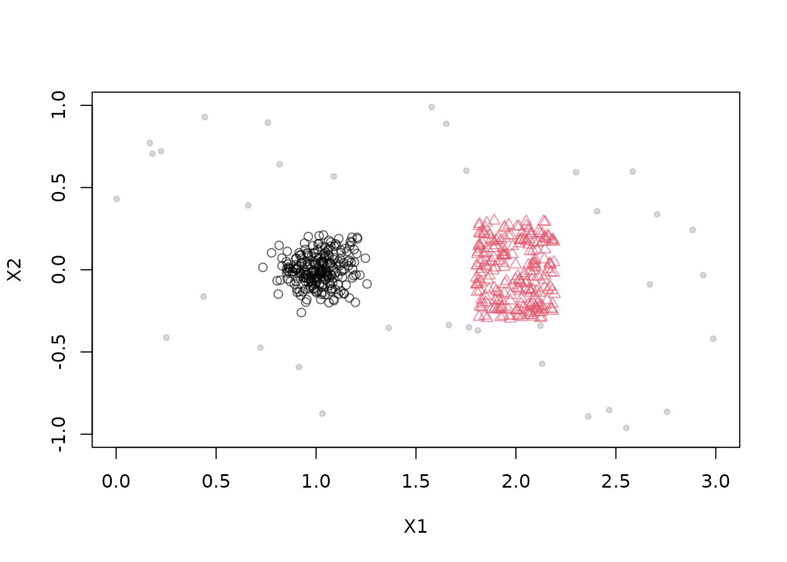
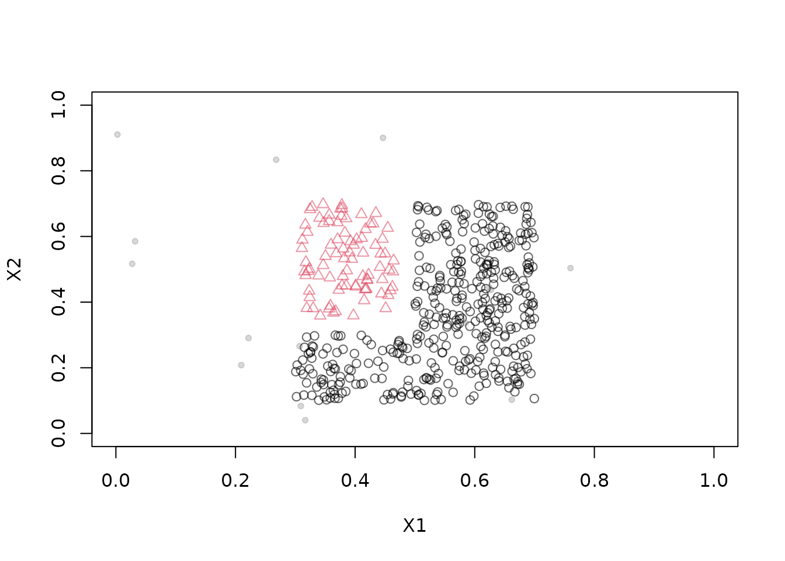
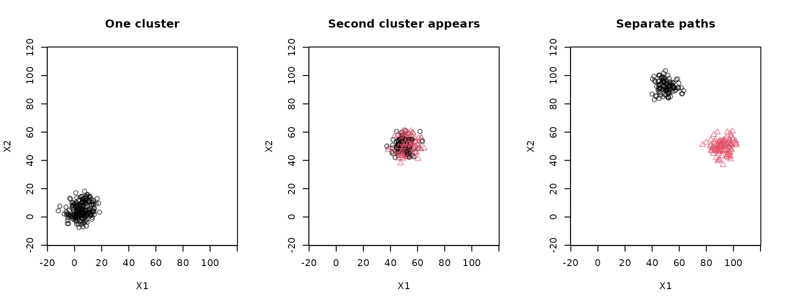
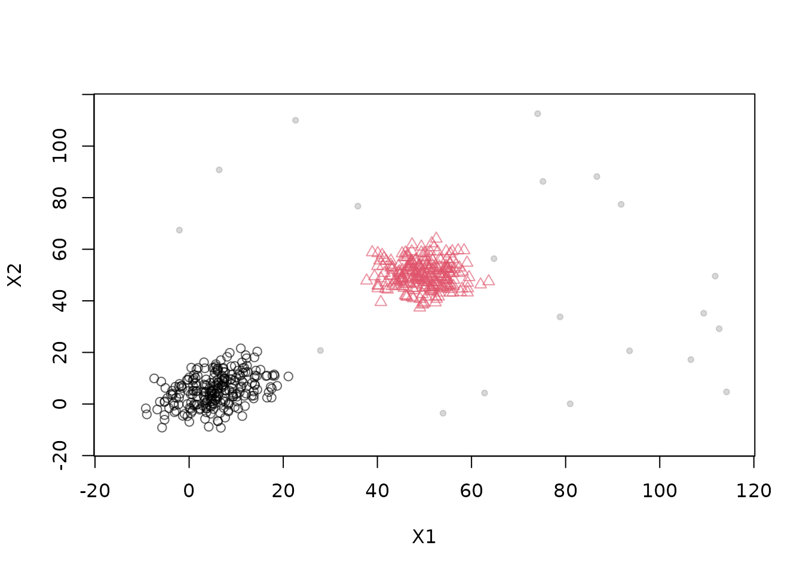
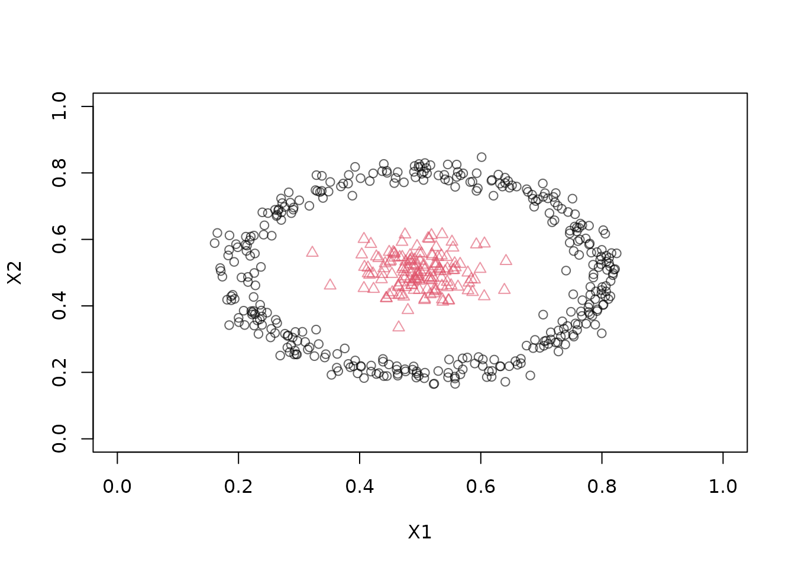

# The DSD Moving Generator: A flexible Framework to Construct Non-Stationary Data Stream

Testing stream clustering algorithms on non-stationary data requires
streams where the ground truth is known and the way the data changes can
be controlled: clusters that move, grow, shrink, appear, disappear,
split or merge. The
[`DSD_MG()`](https://michael.hahsler.net/stream/reference/DSD_MG.md)
generator, the Moving Generator, provides a flexible framework for
building such streams **from individual components**.

Instead of one fixed model, a `DSD_MG` stream is assembled from a list
of **Moving Generator Clusters** (`MGC`s). Each `MGC` is a small,
independent component that describes a single cluster:

- *where* it is (its center),
- *how big* it is and what *shape* it has (the shape parameters),
- *how many points* it produces (its density),

and, for moving components, how these properties change over time.
[`DSD_MG()`](https://michael.hahsler.net/stream/reference/DSD_MG.md)
combines the components into one stream. Because every component has its
own behavior, mixing different components creates complex evolving
streams from simple building blocks. This guide introduces the
components, shows how to combine them, and shows how to change a stream
after it has been created. See the help pages
[`?DSD_MG`](https://michael.hahsler.net/stream/reference/DSD_MG.md) and
[`?MGC`](https://michael.hahsler.net/stream/reference/MGC.md) for the
complete documentation.

## Building blocks

The following components are available. All components for a stream must
have the stream’s dimensionality.

| Component | Behavior |
|:---|:---|
| [`MGC_Static()`](https://michael.hahsler.net/stream/reference/MGC.md) | A cluster at a fixed position. |
| [`MGC_Noise()`](https://michael.hahsler.net/stream/reference/MGC.md) | Uniform random noise in a given area. |
| [`MGC_Linear()`](https://michael.hahsler.net/stream/reference/MGC.md) | A cluster whose center, density, and shape parameters are interpolated between **keyframes**. |
| [`MGC_Function()`](https://michael.hahsler.net/stream/reference/MGC.md) | A cluster where density, center, and shape parameters are **functions of time**. |
| [`MGC_Random()`](https://michael.hahsler.net/stream/reference/MGC.md) | A cluster that follows a **random walk**. |

The shape of a cluster is given by the `shape` argument, which is a
function that draws a single point from the cluster. Two shapes are
provided: `Shape_Gaussian` (the default, where `parameter` is the
standard deviation, one per dimension) and `Shape_Block` (a uniform
block, where `parameter` gives the side lengths). If a single value is
given, it is recycled for all dimensions. New shapes can be defined as
functions with the arguments `center` and `parameter` that return a
single point (see the end of this guide).

## How the generator works

Generation is driven by a *generator time* that advances as points are
drawn. Each component has a `density`. To produce a point,
[`DSD_MG()`](https://michael.hahsler.net/stream/reference/DSD_MG.md)
chooses a component with a probability proportional to the current
densities of all components, and then draws a point from the chosen
component’s shape at its current center. The density therefore controls
both the relative chance of choosing a component and, through the total
density, how fast generator time advances: with a total density of 100,
approximately 100 points advance the generator by one time unit.
Components that change over time thus change what the stream looks like,
and components can be added or removed at any time.

Each point is returned with a `.class` column containing the label of
the component that produced it. Components can share a label to form one
ground-truth cluster, and noise has the label `NA`.

## Combine static clusters and noise

Start with a Gaussian cluster, a uniform rectangular cluster, and
uniform background noise. `parameter` gives standard deviations for
`Shape_Gaussian` and side lengths for `Shape_Block`. By default each
component gets its own label; we set them explicitly here and use `NA`
for the noise.

``` r

stream <- DSD_MG(dimension = 2,
  MGC_Static(density = 45, center = c(1, 0), parameter = 0.1),
  MGC_Static(density = 45, center = c(2, 0), parameter = c(0.4, 0.6),
    shape = Shape_Block),
  MGC_Noise(density = 10, range = rbind(c(0, 3), c(-1, 1))),
  labels = c(1, 2, NA)
)
stream
#> Moving Data GeneratorClass: DSD_MG, DSD_R, DSD 
#> With 3 clusters in 2 dimensions. Time is 1
get_points(stream, n = 5)
#>         X1          X2 .class
#> 1 1.827095  0.14322891      2
#> 2 1.021095 -0.06553463      1
#> 3 2.102185 -0.10974945      2
#> 4 1.110681 -0.14546372      1
#> 5 1.034556  0.02119348      1
plot(stream, n = 500, xlim = c(0, 3), ylim = c(-1, 1))
```



The total density is 100, so approximately 100 points advance the
generator by one time unit, and the Gaussian component produces about
45% of the points. Noise has label `NA` in the `.class` column.

Supplying the same label to several components makes them form one
ground-truth cluster. This makes it easy to build clusters with
non-convex shapes. Here three blocks form an L-shaped cluster (label 1)
next to a second cluster (label 2):

``` r

stream <- DSD_MG(dimension = 2,
  MGC_Static(density = 10, center = c(.5, .2), parameter = c(.4, .2),
    shape = Shape_Block),
  MGC_Static(density = 10, center = c(.6, .5), parameter = c(.2, .4),
    shape = Shape_Block),
  MGC_Static(density = 5, center = c(.39, .53), parameter = c(.16, .35),
    shape = Shape_Block),
  MGC_Noise(density = 1, range = rbind(c(0, 1), c(0, 1))),
  labels = c(1, 1, 2, NA)
)
plot(stream, n = 500, xlim = c(0, 1), ylim = c(0, 1))
```



## Define movement with keyframes

[`MGC_Linear()`](https://michael.hahsler.net/stream/reference/MGC.md)
interpolates the center, density, and shape parameters between
keyframes. This lets you describe movement, growth, and appearance of a
cluster with a few points in time. The next example starts with one
cluster. At time 50, a second component appears at the same location,
then moves in another direction. This simulates a cluster that splits.

``` r

c1 <- MGC_Linear(dimension = 2, keyframelist = list(
  keyframe(time = 1, density = 20, center = c(0, 0), parameter = 5),
  keyframe(time = 50, density = 20, center = c(50, 50), parameter = 5),
  keyframe(time = 100, density = 20, center = c(50, 100), parameter = 5)
))
c2 <- MGC_Linear(dimension = 2, keyframelist = list(
  keyframe(time = 50, density = 20, center = c(50, 50), parameter = 5),
  keyframe(time = 100, density = 20, center = c(100, 50), parameter = 5)
))
stream <- DSD_MG(dimension = 2, c1, c2)
get_keyframes(c1)
#>   time parameter density centers reset
#> 1    1         5      20    0, 0 FALSE
#> 2   50         5      20  50, 50 FALSE
#> 3  100         5      20 50, 100 FALSE
```

A linear component produces no points before its first keyframe. After
its last keyframe it keeps its final attributes. A keyframe with
`reset = TRUE` can make the trajectory repeat, as in `DSD_Benchmark(1)`.

Generator time is different from the count of requested points. The
second component starts after about 980 points: 49 time units at density
20. Once it appears, the total density becomes 40. Plot three short
sections around this change and near the end of the movement:

``` r

local({
  old_par <- par(mfrow = c(1, 3))
  on.exit(par(old_par))
  plot(stream, n = 200, xlim = c(-15, 115), ylim = c(-15, 115),
    main = "One cluster")
  invisible(get_points(stream, n = 780))
  plot(stream, n = 200, xlim = c(-15, 115), ylim = c(-15, 115),
    main = "Second cluster appears")
  invisible(get_points(stream, n = 1400))
  plot(stream, n = 200, xlim = c(-15, 115), ylim = c(-15, 115),
    main = "Separate paths")
})
```



Keyframes can also be added to an existing component with
[`add_keyframe()`](https://michael.hahsler.net/stream/reference/MGC.md),
and removed with
[`remove_keyframe()`](https://michael.hahsler.net/stream/reference/MGC.md).
Each keyframe can use a different density or shape parameter, so a
cluster can also grow, shrink, fade in, or fade out.

``` r

c3 <- MGC_Linear(dimension = 2, shape = Shape_Block)
add_keyframe(c3, time = 1, density = 25, parameter = c(10, 10), center = c(0, 0))
add_keyframe(c3, time = 100, density = 25, parameter = c(30, 30),
  center = c(100, 100))
get_keyframes(c3)
#>   time parameter density  centers reset
#> 1    1    10, 10      25     0, 0 FALSE
#> 2  100    30, 30      25 100, 100 FALSE
```

## Specify movement as a function of time

[`MGC_Function()`](https://michael.hahsler.net/stream/reference/MGC.md)
accepts functions of generator time for density, center, and shape
parameters. This allows arbitrary trajectories without defining
keyframes. For example, a block-shaped cluster can move along the
diagonal while it grows:

``` r

growing <- MGC_Function(
  density = function(t) 100,
  parameter = function(t) 1 * t,
  center = function(t) c(t, t),
  shape = Shape_Block
)
```

Here a Gaussian cluster travels around a circle while a static cluster
remains at the center.

``` r

orbit <- MGC_Function(
  density = function(t) 20,
  center = function(t) c(0.5 + 0.35 * cos(t / 10),
    0.5 + 0.35 * sin(t / 10)),
  parameter = function(t) 0.03
)
stream <- DSD_MG(dimension = 2, orbit,
  MGC_Static(density = 5, center = c(0.5, 0.5), parameter = 0.03))
```

The GIF below shows the functional generator in batches of 50 points,
making the orbiting cluster’s movement visible. It loops automatically
at ten frames per second and is embedded directly in the HTML.

Knitr creates the GIF using the `gifski` R package. Install `gifski`
before rendering to include the animation. The animation chunk is
skipped when `gifski` is unavailable or the output is not HTML.

``` r

local({
  set.seed(1000)
  reset_stream(stream)
  for (i in seq_len(30)) {
    plot(stream, n = 50, xlim = c(0, 1), ylim = c(0, 1),
      main = paste("Moving Generator after", i * 50, "points"))
  }
})
```


For interactive exploration, the following example uses the `animation`
package and is not run during vignette builds.

``` r

reset_stream(stream)
animate_data(stream, n = 1500, horizon = 100,
  xlim = c(0, 1), ylim = c(0, 1))
animation::ani.replay()
```

## Clusters that move randomly

[`MGC_Random()`](https://michael.hahsler.net/stream/reference/MGC.md)
creates a cluster that follows a random walk. `center` is its starting
position and `randomness` is the maximum amount it moves in one time
step. Mixing random and static components gives streams where some
clusters drift unpredictably while others stay in place.

``` r

stream <- DSD_MG(dimension = 2,
  MGC_Random(density = 100, center = c(1, 0), parameter = 0.1,
    randomness = 0.2),
  MGC_Random(density = 100, center = c(2, 0), parameter = 0.4,
    shape = Shape_Block, randomness = 0.2)
)
stream
#> Moving Data GeneratorClass: DSD_MG, DSD_R, DSD 
#> With 2 clusters in 2 dimensions. Time is 1
```

## Add and remove components

Generators can be modified after construction, so a stream can be
changed while it is running.
[`get_clusters()`](https://michael.hahsler.net/stream/reference/DSD_MG.md)
returns the component list;
[`add_cluster()`](https://michael.hahsler.net/stream/reference/DSD_MG.md)
adds a component and
[`remove_cluster()`](https://michael.hahsler.net/stream/reference/DSD_MG.md)
takes an index in that list.

``` r

stream <- DSD_MG(dimension = 2,
  MGC_Linear(dimension = 2, keyframelist = list(
    keyframe(time = 1, density = 20, center = c(0, 0), parameter = 5),
    keyframe(time = 100, density = 20, center = c(100, 100), parameter = 5))),
  MGC_Static(density = 20, center = c(50, 50), parameter = 5))

noise <- MGC_Noise(density = 2, range = rbind(c(-15, 115), c(-15, 115)))
add_cluster(stream, noise, label = NA)
length(get_clusters(stream))
#> [1] 3
plot(stream, n = 500, xlim = c(-15, 115), ylim = c(-15, 115))
```



``` r

remove_cluster(stream, i = 3)
length(get_clusters(stream))
#> [1] 2
```

Use
[`add_keyframe()`](https://michael.hahsler.net/stream/reference/MGC.md)
and
[`remove_keyframe()`](https://michael.hahsler.net/stream/reference/MGC.md)
to edit a linear component’s trajectory. Stream and component objects
contain mutable state: updating a component can also affect a stream
that contains it.

## Define your own shape

A shape is a function with the arguments `center` and `parameter` that
returns a single point. As an example, here is a ring shape in two
dimensions, where `parameter` is the radius and the points are spread
uniformly around the center with a little noise.

``` r

Shape_Ring <- function(center, parameter) {
  angle <- runif(1, 0, 2 * pi)
  center + rnorm(1, mean = parameter[1], sd = 0.02) * c(cos(angle), sin(angle))
}

stream <- DSD_MG(dimension = 2,
  MGC_Static(density = 50, center = c(0.5, 0.5), parameter = 0.3,
    shape = Shape_Ring),
  MGC_Static(density = 25, center = c(0.5, 0.5), parameter = 0.05)
)
plot(stream, n = 500, xlim = c(0, 1), ylim = c(0, 1))
```



## Use the stream

A `DSD_MG` stream is a regular `DSD` object. It can be used like any
other stream to cluster and evaluate, for example with
[`update()`](https://michael.hahsler.net/stream/reference/update.md) and
[`evaluate_stream()`](https://michael.hahsler.net/stream/reference/evaluate.md).
Because the generator knows which component produced each point, the
true labels are available for external evaluation, even when the
clusters move. See [Evaluating Non-stationary
Clusters](https://michael.hahsler.net/stream/articles/moving_data.md)
for how to evaluate clustering on moving data and [Clustering data
streams with
DBSTREAM](https://michael.hahsler.net/stream/articles/DBSTREAM.md) for a
clustering algorithm that is able to follow such streams.
