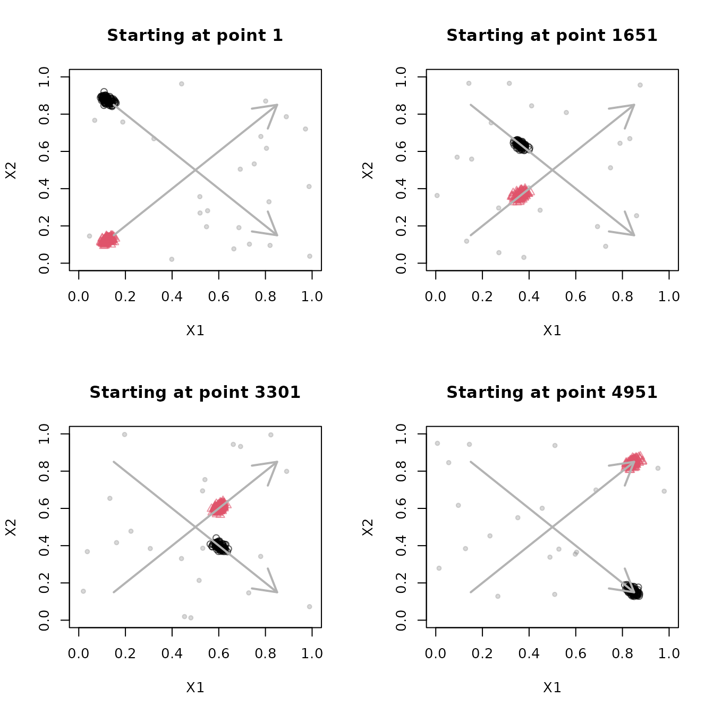
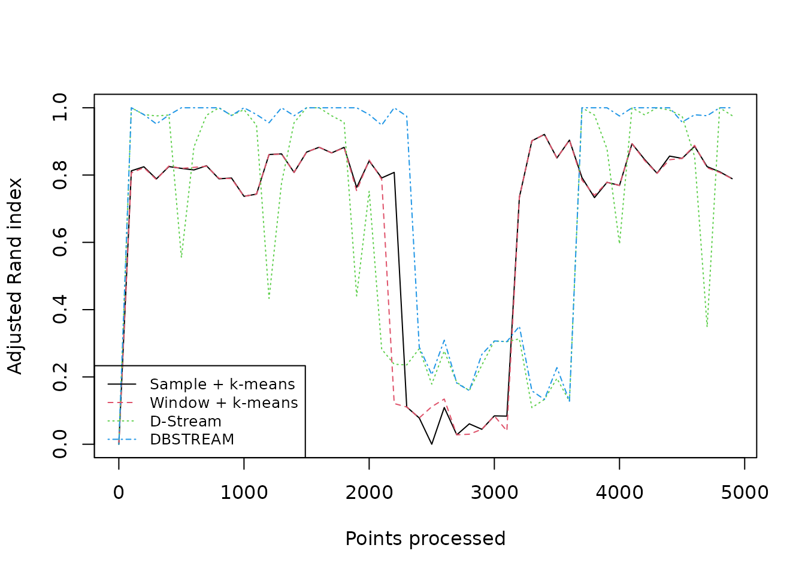
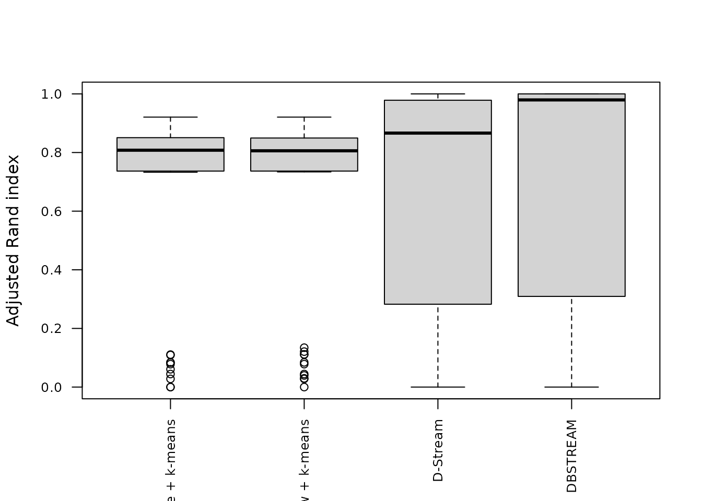

# Clustering moving data

In an evolving stream, the distribution of incoming points changes over
time. A clustering model needs to forget outdated observations to follow
this concept drift. This guide adapts the moving-cluster and
evolving-stream comparison examples from the package’s original
`stream_vignette.Rnw`.

## Inspect moving clusters

`DSD_Benchmark(1)` generates two clusters that move diagonally across
the unit square and intersect in the middle, together with background
noise.

``` r

stream <- DSD_Benchmark(1)
stream
#> Benchmark 1: Two clusters moving diagonally from left to right, meeting
#> in the center (d = 2, k = 2, 5% noise).Class: DSD_MG, DSD_R, DSD 
#> With 3 clusters in 2 dimensions. Time is 1
```

Plot four short sections of the stream, skipping 1400 points between
plots. Fixed axis limits make the movement visible. Both
[`plot()`](https://michael.hahsler.net/stream/reference/plot.DSD.md) and
[`get_points()`](https://michael.hahsler.net/stream/reference/get_points.md)
advance the stream.

``` r

local({
  old_par <- par(mfrow = c(2, 2))
  on.exit(par(old_par))
  for (i in seq_len(4)) {
    plot(stream, n = 250, xlim = c(0, 1), ylim = c(0, 1),
      main = paste("Starting at point", 1 + (i - 1) * 1650))
    arrows(0.15, 0.85, 0.85, 0.15, col = "gray70", lwd = 2)
    arrows(0.15, 0.15, 0.85, 0.85, col = "gray70", lwd = 2)
    if (i < 4) invisible(get_points(stream, n = 1400))
  }
})
```



The arrows indicate the directions of travel. Near the crossing, the two
generating clusters overlap, making them difficult to distinguish using
only the observed features.

## Compare models on the same points

Generate and store 5000 points. Resetting a `DSD_Memory` stream replays
the same points, which makes comparisons fair. Resetting a generator
resets its position but does not in general reproduce the same random
observations.

``` r

set.seed(0)
stream <- DSD_Memory(DSD_Benchmark(1), n = 5000)
```

Compare a sample biased toward recent data, a fading sliding window,
D-Stream, and DBSTREAM. The sample and window use k-means to form two
macro-clusters. D-Stream and DBSTREAM determine macro-clusters using
their built-in methods. We use `lambda = 0.01` for the window and
density-based methods to forget older points quickly enough to follow
the movement.

``` r

algorithms <- list(
  "Sample + k-means" = DSC_TwoStage(
    micro = DSC_Sample(k = 100, biased = TRUE),
    macro = DSC_Kmeans(k = 2)),
  "Window + k-means" = DSC_TwoStage(
    micro = DSC_Window(horizon = 100, lambda = 0.01),
    macro = DSC_Kmeans(k = 2)),
  "D-Stream" = DSC_DStream(gridsize = 0.1, lambda = 0.01),
  "DBSTREAM" = DSC_DBSTREAM(r = 0.05, lambda = 0.01)
)
```

[`evaluate_stream()`](https://michael.hahsler.net/stream/reference/evaluate.md)
uses prequential evaluation: it evaluates the current model on the next
batch, then updates the model with those points. Here each batch
contains 100 points, producing 50 evaluations per model. The adjusted
Rand index (`crand`) compares the macro-clustering with the true cluster
labels. Assignments go through micro-clusters to retain the shape of
density-based macro-clusters.

``` r

evaluation <- lapply(algorithms, function(model) {
  reset_stream(stream)
  evaluate_stream(model, stream, horizon = 100, n = 5000,
    measure = "crand", type = "macro", assign = "micro")
})
scores <- sapply(evaluation, function(x) x[, "crand"])
head(scores)
#>      Sample + k-means Window + k-means  D-Stream  DBSTREAM
#> [1,]        0.0000000        0.0000000 0.0000000 0.0000000
#> [2,]        0.8125882        0.8066434 1.0000000 1.0000000
#> [3,]        0.8246465        0.8219442 0.9797314 0.9797314
#> [4,]        0.7885402        0.7866667 0.9757549 0.9519319
#> [5,]        0.8252665        0.8267911 0.9783402 0.9783402
#> [6,]        0.8198207        0.8198207 0.5546576 1.0000000
```

The first score is `NA` because each model starts empty. Plot the scores
over time and compare their distributions over the stream.

``` r

position <- evaluation[[1]][, "points"]
matplot(position, scores, type = "l", lwd = 1,
  xlab = "Points processed", ylab = "Adjusted Rand index")
legend("bottomleft", legend = names(algorithms),
  col = seq_along(algorithms), lty = seq_along(algorithms), cex = 0.8)
```



``` r

boxplot(scores, las = 2, cex.axis = 0.8, ylab = "Adjusted Rand index")
```



Read the score trajectories alongside the snapshots: overlap can lower
quality even when a model follows the movement. The methods also differ
in their noise handling; k-means assigns points to a cluster, while the
density-based methods can leave points unassigned. These settings
illustrate one experiment rather than establishing a ranking across
streams.

## Animate the stream and clustering

The following animation shows 5000 points in batches of 100, with
DBSTREAM’s micro- and macro-clusters overlaid. The GIF loops
automatically, displaying ten frames per second. It is embedded directly
in the HTML, so the document can be shared without separate image files.

Knitr creates the GIF using the `gifski` R package; FFmpeg is not
required. Install `gifski` before rendering to include the animation.
The animation chunk is skipped when `gifski` is unavailable or the
output is not HTML.

``` r

local({
  set.seed(1000)
  animation_stream <- DSD_Benchmark(1)
  animation_model <- DSC_DBSTREAM(r = 0.05, lambda = 0.01)
  for (i in seq_len(50)) {
    batch <- get_points(animation_stream, n = 100)
    update(animation_model, batch)
    plot(animation_model, remove_info(batch), type = "both",
      xlim = c(0, 1), ylim = c(0, 1),
      main = paste("DBSTREAM after", i * 100, "points"))
  }
})
```


For interactive exploration, the following examples use the package’s
animation helpers. They are not run when building the vignette. Start
with a fresh stream and model.

``` r

stream <- DSD_Benchmark(1)
animate_data(stream, n = 5000, horizon = 100,
  xlim = c(0, 1), ylim = c(0, 1))

stream <- DSD_Benchmark(1)
model <- DSC_DBSTREAM(r = 0.05, lambda = 0.01)
animate_cluster(model, stream, n = 5000, horizon = 100,
  measure = "crand", type = "macro", assign = "micro",
  plot.args = list(xlim = c(0, 1), ylim = c(0, 1), type = "both"))
```
