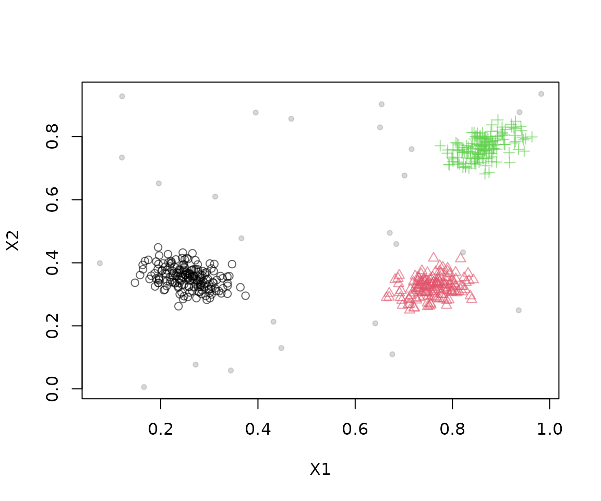
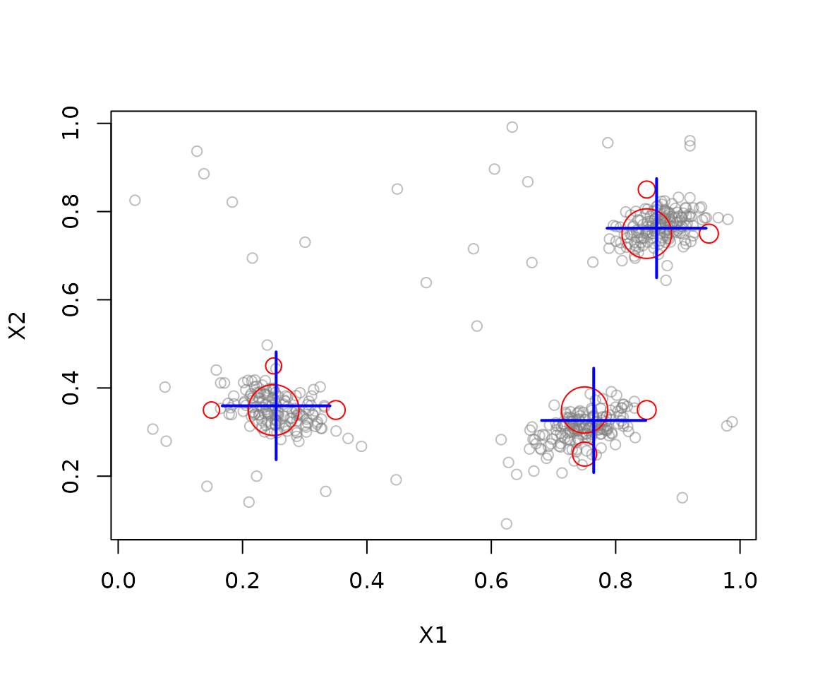
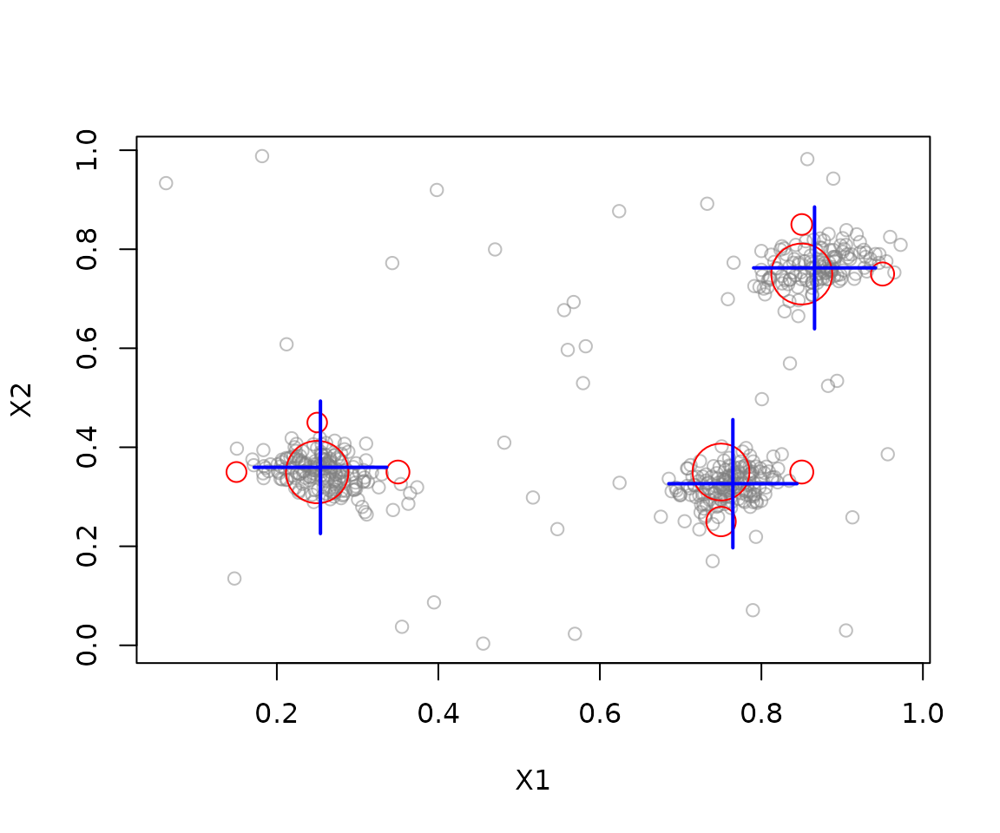
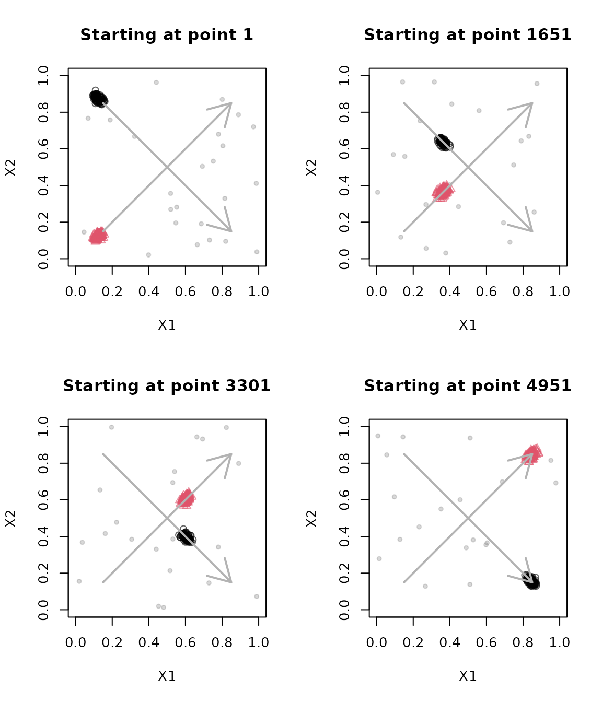
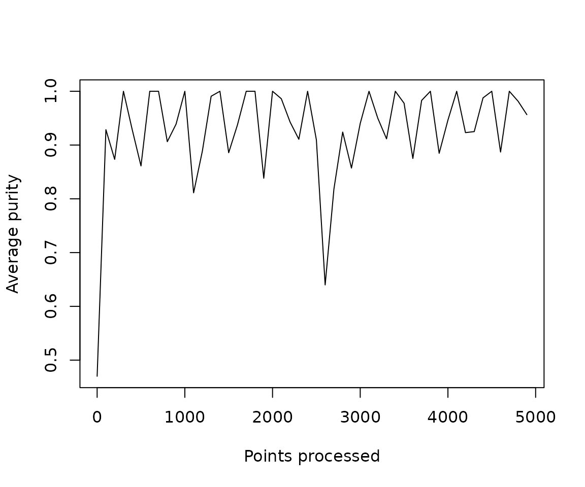

# Getting started with stream

The `stream` package provides an R framework for data stream mining. A
data stream is a potentially unbounded sequence of observations that can
only be read once, in order, so models have to be updated incrementally
with limited memory. This guide introduces the main building blocks of
the package and walks through a complete clustering workflow:

- **Data stream data (DSD)** objects generate or read points. They
  include simulated generators, replay of stored data, and files read in
  chunks.
- **Data stream task (DST)** are mining models that are updated with new
  points. This guide uses data stream clustering (DSC) objects, which
  combine online micro-clusters with offline macro-clusters.
- **Evaluation** measures the quality of a clustering on new points,
  either at one moment or continuously along the stream.
- **Non-stationary streams** have a distribution that changes over time
  (concept drift), so a model needs to forget outdated observations, and
  evaluation needs to be adapted to this setting.

## Installation

Install the released package from CRAN, then load it in your R session:

``` r

install.packages("stream")
```

``` r

library(stream)
```

## Data streams (DSD)

### Create and inspect a stream

[`DSD_Gaussians()`](https://michael.hahsler.net/stream/reference/DSD_Gaussians.md)
generates points from randomly placed Gaussian clusters. Here we create
three clusters in two dimensions, with 5% of the points being noise.
Setting the random seed makes simulated data reproducible.

``` r

set.seed(1000)
stream <- DSD_Gaussians(k = 3, d = 2, noise = 0.05)
stream
#> Gaussian Mixture (d = 2, k = 3) 
#> Class: DSD_Gaussians, DSD_R, DSD
```

A stream can be unbounded, so we request a finite number of points with
[`get_points()`](https://michael.hahsler.net/stream/reference/get_points.md).
Every request advances the stream, so the next call returns new points.

``` r

get_points(stream, n = 5)
#>          X1        X2 .class
#> 1 0.7826162 0.3525620      2
#> 2 0.8594462 0.7633726      3
#> 3 0.9171496 0.7974878      3
#> 4 0.7502471 0.3129352      2
#> 5 0.9436874 0.8162179      3
```

The result is a data frame with the features as columns. Columns
starting with a dot contain additional information. `.class` is the
ground truth, i.e., the cluster that generated the point, and is `NA`
for noise. Use `info = FALSE` to get only the features. Plot a sample of
the stream to see its structure; the true classes are used for colors
and symbols, and noise is gray.

``` r

plot(stream, n = 500)
```



Other generators include
[`DSD_BarsAndGaussians()`](https://michael.hahsler.net/stream/reference/DSD_BarsAndGaussians.md),
[`DSD_mlbenchData()`](https://michael.hahsler.net/stream/reference/DSD_mlbenchData.md)
for the data sets in package `mlbench`,
[`DSD_MG()`](https://michael.hahsler.net/stream/reference/DSD_MG.md) for
custom moving generators (see [The DSD Moving
Generator](https://michael.hahsler.net/stream/articles/DSD_MG.md)), and
[`DSD_Benchmark()`](https://michael.hahsler.net/stream/reference/DSD_Benchmark.md)
which we use below. Use `plot(stream, method = "pc")` to project data
with more than two dimensions onto its first two principal components.

### Replay stored data

To test algorithms on exactly the same points, store them with
[`DSD_Memory()`](https://michael.hahsler.net/stream/reference/DSD_Memory.md).
It turns a matrix or data frame into a stream, and the position can be
reset with
[`reset_stream()`](https://michael.hahsler.net/stream/reference/reset_stream.md).
This is also useful for data that is already in R. Here we use the daily
closing prices of four European stock indices.

``` r

replayer <- DSD_Memory(EuStockMarkets, k = NA)
replayer
#> Memorized Stream 
#> Class: DSD_Memory, DSD_R, DSD 
#> Contains 1860 data points - currently at position 1 - loop is FALSE
get_points(replayer, n = 3)
#>       DAX    SMI    CAC   FTSE
#> 1 1628.75 1678.1 1772.8 2443.6
#> 2 1613.63 1688.5 1750.5 2460.2
#> 3 1606.51 1678.6 1718.0 2448.2
replayer
#> Memorized Stream 
#> Class: DSD_Memory, DSD_R, DSD 
#> Contains 1860 data points - currently at position 4 - loop is FALSE
reset_stream(replayer)
get_points(replayer, n = 1)
#>       DAX    SMI    CAC   FTSE
#> 1 1628.75 1678.1 1772.8 2443.6
```

You can also store a part of a generated stream:
`DSD_Memory(stream, n = 1000)` draws 1000 points once and then replays
them.

### Read and write streams

Parts of a stream can be written to disk with
[`write_stream()`](https://michael.hahsler.net/stream/reference/write_stream.md).
[`DSD_ReadCSV()`](https://michael.hahsler.net/stream/reference/DSD_ReadStream.md)
reads a file in chunks, so files larger than the available memory can be
processed one block at a time. The package includes a compressed sample
of the KDD Cup 1999 network intrusion data. We select some of the
numeric columns as features and use the last column as the class label.

``` r

file <- system.file("examples", "kddcup10000.data.gz", package = "stream")
stream_file <- DSD_ReadCSV(gzfile(file),
  take = c(1, 5, 6, 8:11, 13:20, 23:41, .class = 42), k = 7)
stream_file
#> Data Stream from Connection (d = 34, k = 7) 
#> Class: DSD_ReadStream, DSD_R, DSD 
#> connection: kddcup10000.data.gz (opened)
head(get_points(stream_file, n = 5), 3)
#>   V1  V5    V6 V8 V9 V10 V11 V13 V14 V15 V16 V17 V18 V19 V20 V23 V24 V25 V26
#> 1  0 215 45076  0  0   0   0   0   0   0   0   0   0   0   0   1   1   0   0
#> 2  0 162  4528  0  0   0   0   0   0   0   0   0   0   0   0   2   2   0   0
#> 3  0 236  1228  0  0   0   0   0   0   0   0   0   0   0   0   1   1   0   0
#>   V27 V28 V29 V30 V31 V32 V33 V34 V35 V36 V37 V38 V39 V40 V41  .class
#> 1   0   0   1   0   0   0   0   0   0 0.0   0   0   0   0   0 normal.
#> 2   0   0   1   0   0   1   1   1   0 1.0   0   0   0   0   0 normal.
#> 3   0   0   1   0   0   2   2   1   0 0.5   0   0   0   0   0 normal.
```

No data is read until
[`get_points()`](https://michael.hahsler.net/stream/reference/get_points.md)
is called. Writing works the other way around:

``` r

tmp <- tempfile(fileext = ".csv")
write_stream(DSD_Gaussians(k = 3, d = 2), tmp, n = 100, sep = ",")
head(read.csv(tmp, header = FALSE), 3)
#>          V1        V2
#> 1 0.8271649 0.6256257
#> 2 0.8132347 0.9186943
#> 3 0.9411556 0.2142509
unlink(tmp)
```

### Transform a stream

Stream filters (`DSF_`) transform a stream while it is read. This is
useful for clustering, where features often need to be on the same
scale.
[`DSF_Scale()`](https://michael.hahsler.net/stream/reference/DSF_Scale.md)
centers and scales a stream using the first 1000 points. It takes the
stream as its first argument, so it can also be used in a pipe.

``` r

stream_scaled <- DSF_Scale(stream_file, center = TRUE, scale = TRUE)
head(get_points(stream_scaled, n = 5), 3)
#>   V1         V5         V6 V8 V9        V10 V11 V13 V14 V15 V16 V17 V18 V19 V20
#> 1  0 -0.2277873 -0.1896079  0  0 -0.1421411   0   0   0   0   0   0   0   0   0
#> 2  0 -0.2008939 -0.4941091  0  0 -0.1421411   0   0   0   0   0   0   0   0   0
#> 3  0 -0.2008939 -0.4994490  0  0 -0.1421411   0   0   0   0   0   0   0   0   0
#>        V23      V24 V25 V26 V27 V28 V29 V30        V31        V32      V33 V34
#> 1 3.380457 3.172740   0   0   0   0   0   0 -0.2903826 -0.4474209 1.740690   0
#> 2 3.730763 3.512798   0   0   0   0   0   0 -0.2903826 -0.3952739 1.775159   0
#> 3 4.081070 3.852856   0   0   0   0   0   0 -0.2903826 -0.3431270 1.809628   0
#>   V35        V36      V37 V38 V39 V40 V41  .class
#> 1   0 -0.3447832 1.456919   0   0   0   0 normal.
#> 2   0 -0.3447832 1.456919   0   0   0   0 normal.
#> 3   0 -0.3926033 1.456919   0   0   0   0 normal.
```

## Cluster a stream (DSC)

A data stream clustering (DSC) object holds a model and is updated
incrementally. Most algorithms work in two stages: an *online* component
summarizes the stream in many small **micro-clusters** while the data
arrives, and an *offline* component groups the micro-clusters into the
final **macro-clusters** when they are needed. Implemented algorithms
include D-Stream
([`DSC_DStream()`](https://michael.hahsler.net/stream/reference/DSC_DStream.md)),
DBSTREAM
([`DSC_DBSTREAM()`](https://michael.hahsler.net/stream/reference/DSC_DBSTREAM.md)),
BIRCH
([`DSC_BIRCH()`](https://michael.hahsler.net/stream/reference/DSC_BIRCH.md)),
and sliding windows and samples
([`DSC_Window()`](https://michael.hahsler.net/stream/reference/DSC_Window.md),
[`DSC_Sample()`](https://michael.hahsler.net/stream/reference/DSC_Sample.md)).
Macro-clustering methods such as
[`DSC_Kmeans()`](https://michael.hahsler.net/stream/reference/DSC_Kmeans.md)
and
[`DSC_Hierarchical()`](https://michael.hahsler.net/stream/reference/DSC_Hierarchical.md)
can be used to recluster the micro-clusters.

### Cluster the stream

D-Stream assigns points to the cells of a grid and groups dense,
adjacent cells. We create a model with a cell size of 0.1 on a stream
with three clusters.

``` r

set.seed(1000)
stream <- DSD_Gaussians(k = 3, d = 2, noise = 0.05)
dstream <- DSC_DStream(gridsize = 0.1, Cm = 1.2)
dstream
#> D-Stream 
#> Class: DSC_DStream, DSC_Micro, DSC_R, DSC 
#> Number of micro-clusters: 0 
#> Number of macro-clusters: 0
```

[`update()`](https://michael.hahsler.net/stream/reference/update.md)
feeds points from the stream into the model. DSC objects are mutable, so
[`update()`](https://michael.hahsler.net/stream/reference/update.md)
changes `dstream` in place and no assignment is needed.

``` r

update(dstream, stream, n = 500)
dstream
#> D-Stream 
#> Class: DSC_DStream, DSC_Micro, DSC_R, DSC 
#> Number of micro-clusters: 10 
#> Number of macro-clusters: 3
```

Inspect the number of clusters and their centers, then plot the
micro-clusters (red, with size showing weight) on top of new points from
the stream. D-Stream has built-in reclustering, and `type = "both"` also
shows its macro-clusters as blue crosses.

``` r

nclusters(dstream, type = "micro")
#> [1] 10
nclusters(dstream, type = "macro")
#> [1] 3
head(get_centers(dstream, type = "micro"), 3)
#>     X1   X2
#> 1 0.15 0.35
#> 2 0.25 0.35
#> 3 0.25 0.45
plot(dstream, stream, type = "both")
```



### Recluster the micro-clusters

D-Stream’s built-in reclustering joins adjacent dense cells, which can
have trouble separating overlapping clusters. Micro-clusters from any
algorithm can be reclustered with any macro-clustering algorithm using
[`recluster()`](https://michael.hahsler.net/stream/reference/recluster.md).
Here we use weighted k-means with `k = 3`, where the weights are the
numbers of points represented by the micro-clusters.

``` r

kmeans_macro <- DSC_Kmeans(k = 3, weighted = TRUE)
recluster(kmeans_macro, dstream)
plot(kmeans_macro, stream, type = "both")
```



Components can also be combined into a single model with
[`DSC_TwoStage()`](https://michael.hahsler.net/stream/reference/DSC_TwoStage.md),
for example
`DSC_TwoStage(micro = DSC_Window(horizon = 100), macro = DSC_Kmeans(k = 3))`,
which is then updated like any other DSC object.

## Evaluate a clustering

[`evaluate_static()`](https://michael.hahsler.net/stream/reference/evaluate.md)
tests the current model on new points drawn from a stream without
updating it. The generated stream contains the true cluster labels, so
external measures such as purity and the adjusted Rand index (`crand`)
can be calculated. We evaluate the micro-clusters of D-Stream, its
built-in macro-clusters, and the macro-clusters found by k-means. Points
are assigned to the closest micro-cluster, and for macro-clusters this
assignment is translated to the macro-cluster that contains the
micro-cluster.

``` r

evaluate_static(dstream, stream, n = 500,
  measure = c("purity", "crand"), type = "micro")
#> Evaluation results for micro-clusters.
#> Points were assigned to micro-clusters.
#> 
#>    purity     cRand 
#> 0.9348534 0.4899122

evaluate_static(dstream, stream, n = 500,
  measure = c("purity", "crand"), type = "macro")
#> Evaluation results for macro-clusters.
#> Points were assigned to micro-clusters.
#> 
#>    purity     cRand 
#> 0.8453947 0.8283726

evaluate_static(kmeans_macro, stream, n = 500,
  measure = c("purity", "crand"), type = "macro")
#> Evaluation results for macro-clusters.
#> Points were assigned to micro-clusters.
#> 
#>    purity     cRand 
#> 0.9553602 0.9332421
```

Purity of the micro-clusters is high, because each small micro-cluster
covers points from a single true cluster. The adjusted Rand index is
low, because the true clusters are split into many pieces. The
macro-clusters match the true clusters much better. Purity alone rewards
many small clusters, so report it together with the adjusted Rand index.
Leave out `measure` to calculate all available measures, including
internal measures such as the sum of squares (`SSQ`) that do not need
the ground truth. Because the evaluation points are drawn fresh from the
stream, repeated calls give slightly different values.

## Non-stationary streams

In many applications, the distribution of the data changes over time.
This concept drift is the main challenge that sets data stream
clustering apart from clustering static data. `DSD_Benchmark(1)`
generates two clusters that move diagonally across the unit square and
cross in the middle.

``` r

set.seed(1000)
stream <- DSD_Benchmark(1)
stream
#> Benchmark 1: Two clusters moving diagonally from left to right, meeting
#> in the center (d = 2, k = 2, 5% noise).Class: DSD_MG, DSD_R, DSD 
#> With 3 clusters in 2 dimensions. Time is 1
```

To see the movement, we plot four sections of 250 points and skip 1400
points between them. The arrows indicate the direction of travel.

``` r

old_par <- par(mfrow = c(2, 2))
for (i in seq_len(4)) {
  plot(stream, n = 250, xlim = c(0, 1), ylim = c(0, 1),
    main = paste("Starting at point", 1 + (i - 1) * 1650))
  arrows(0.15, 0.85, 0.85, 0.15, col = "gray70", lwd = 2)
  arrows(0.15, 0.15, 0.85, 0.85, col = "gray70", lwd = 2)
  if (i < 4) invisible(get_points(stream, n = 1400))
}
```



``` r

par(old_par)
```

A model for such a stream needs to fade out old points. Both D-Stream
and DBSTREAM have a decay parameter `lambda` for this. Larger values
forget faster.
[`animate_data()`](https://michael.hahsler.net/stream/reference/animate_data.md)
and
[`animate_cluster()`](https://michael.hahsler.net/stream/reference/animate_cluster.md)
create animations of a stream and a clustering as it develops (see
[Evaluating Non-stationary
Clusters](https://michael.hahsler.net/stream/articles/evaluation_non-stationary.md)).

### Evaluate over time with prequential evaluation

A single score computed at one moment cannot show how well a model
follows a changing stream.
[`evaluate_stream()`](https://michael.hahsler.net/stream/reference/evaluate.md)
uses *prequential* (test-then-train) evaluation. It repeatedly evaluates
the model on the next `horizon` points and only then updates the model
with them, so every point is used for testing before it is used for
learning. The result is a time series of scores.

``` r

set.seed(1000)
stream <- DSD_Benchmark(1)
dstream <- DSC_DStream(gridsize = 0.05, lambda = 0.01)
ev <- evaluate_stream(dstream, stream, horizon = 100, n = 5000,
  measure = c("numMicroClusters", "purity"))
head(ev)
#>   points numMicroClusters    purity
#> 1      0                0 0.4700000
#> 2    100                6 0.9285714
#> 3    200                8 0.8733333
#> 4    300               14 1.0000000
#> 5    400               10 0.9285714
#> 6    500                9 0.8611111
```

The first row is computed before the model has seen any points, so it is
not meaningful. Plot the micro-cluster purity over the stream.

``` r

plot(ev[, "points"], ev[, "purity"], type = "l",
  xlab = "Points processed", ylab = "Average purity")
```



Purity is lowest around the middle of the stream, where the two true
clusters overlap, and is higher again once they separate. The vignette
[Evaluating Non-stationary
Clusters](https://michael.hahsler.net/stream/articles/evaluation_non-stationary.md)
compares several algorithms on this stream, uses the adjusted Rand
index, and shows how to tune the forgetting rate.

## Further reading

- [Clustering data streams with
  DBSTREAM](https://michael.hahsler.net/stream/articles/DBSTREAM.md)
  explains micro-clusters and shared-density reclustering.
- [Evaluating Non-stationary
  Clusters](https://michael.hahsler.net/stream/articles/evaluation_non-stationary.md)
  compares clustering methods on an evolving stream using prequential
  evaluation.
- [The DSD Moving
  Generator](https://michael.hahsler.net/stream/articles/DSD_MG.md)
  shows how to construct custom evolving streams.
- The [function
  reference](https://michael.hahsler.net/stream/reference/index.html).

## References

Hahsler, M., Bolaños, M., and Forrest, J. (2017). Introduction to
stream: An extensible framework for data stream clustering research with
R. *Journal of Statistical Software*, 76(14), 1–50.
<doi:10.18637/jss.v076.i14>.
